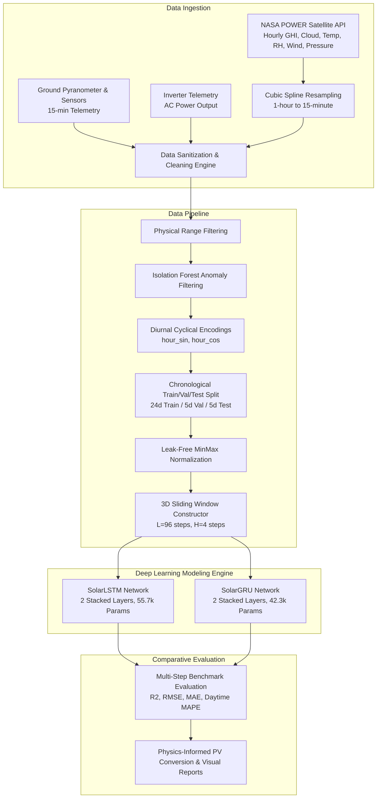

# Project Report: Adaptive Multi-Modal AI Framework for Hyperlocal Weather Forecasting in Distributed Solar Rooftop Systems

**Course**: DBMS BCSE302L — Digital Assignment 1 (DA-1)  
**Authors**: Revanth P. A. (24BCE1730) & Siripuram Srimannath (24BCE5034)  
**Institution**: School of Computer Science and Engineering, Vellore Institute of Technology (VIT)  
**Date**: September 2026  
**Repository**: [github.com/opafkkabaap/solar-hyperlocal-forecasting](https://github.com/opafkkabaap/solar-hyperlocal-forecasting)

---

## Abstract

Distributed solar photovoltaic (PV) rooftop systems are subject to microclimatic perturbations, rapid transients in cloud coverage, and local atmospheric variability. Standard Numerical Weather Prediction (NWP) models operate at lower resolution both spatially and temporally making them ill-suited for high-resolution short-term power forecasting tasks. This project develops an end-to-end operational framework that assimilates heterogeneous multi-modal data streams (on-site ground truth measurements including pyranometer solar irradiance, ambient temperature, and module back-of-panel temperature) and satellite reanalysis meteorological data from the NASA POWER API.

The data engineering pipeline performs physical boundary validation, unsupervised Isolation Forest anomaly sanitization, and cubic spline temporal harmonization from 1-hour feeds down to uniform 15-minute intervals. To eliminate documented reporting unit inconsistencies, grid-deliverable AC power (`total_ac_power`) is established as the sole forecasting target across 13 multi-modal features. We construct and benchmark two recurrent sequential deep learning architectures—**Long Short-Term Memory (LSTM)** and **Gated Recurrent Unit (GRU)**—for multi-step ultra-short-term forecasting ($H = 4$ steps, 1-hour ahead nowcasting). Evaluated strictly on an unseen 5-day chronological test partition, the SolarLSTM model achieves an overall coefficient of determination $R^2 = 0.9034$ ($\text{RMSE} = 2,542.68\text{ kW}$), while the SolarGRU network delivers comparable accuracy ($R^2 = 0.8991$, $\text{RMSE} = 2,598.91\text{ kW}$) with **24.0% fewer trainable parameters** (42,340 vs. 55,716) and faster convergence, demonstrating optimal trade-offs for edge-node microgrid controllers.

---

## 1. System Architecture & Research Motivation

### 1.1 The Multi-Modal Distributed Rooftop Problem
Rooftop photovoltaic generation exhibits sharp, non-linear ramps caused by localized cloud shadow passage and diurnal thermal degradation. Existing literature frequently isolates meteorological forecasting from photovoltaic power conversion or relies exclusively on single-modality inputs.



### 1.2 Core Architectural Dimensions
* **Primary Modality**: Ground-truth on-site pyranometer irradiance, module temperature, ambient temperature, and AC kilowatt generation recorded across two solar installations in India (34 days, May 15 to June 17, 2020 at 15-minute intervals).
* **Secondary Modality**: Hourly NASA POWER REST API feeds for Global Horizontal Irradiance (`ALLSKY_SFC_SW_DWN`), daylight cloud coverage (`CLOUD_AMT`), 2m ambient air temperature (`T2M`), relative humidity (`RH2M`), wind velocity (`WS2M`), atmospheric pressure (`PS`), and clearness index (`ALLSKY_KT`).
* **Geographic Alignment**: Set to the Pune metropolitan region ($18.5204^\circ\text{ N}, 73.8567^\circ\text{ E}$), synchronizing solar zenith angles and macro-weather patterns with physical ground sensors.

---

## 2. Database Management & Ingestion Schema

The database layer utilizes PostgreSQL coupled with time-series hyper-tables to structure observations across uniform 15-minute buckets.

### 2.1 Relational Schema

```sql
-- Weather Station Metadata Entity
CREATE TABLE WeatherStation (
    station_id VARCHAR(50) PRIMARY KEY,
    name VARCHAR(100) NOT NULL,
    latitude NUMERIC(9,6) NOT NULL,
    longitude NUMERIC(9,6) NOT NULL,
    elevation NUMERIC(6,2)
);

-- Multi-Modal Time-Series Hyper-table
CREATE TABLE MultiModalSolarData (
    timestamp TIMESTAMPTZ NOT NULL,
    station_id VARCHAR(50) REFERENCES WeatherStation(station_id),
    total_ac_power NUMERIC(10,3) CHECK (total_ac_power >= 0),
    sensor_irradiation NUMERIC(6,3) CHECK (sensor_irradiation >= 0),
    sensor_ambient_temp NUMERIC(5,2),
    sensor_module_temp NUMERIC(5,2),
    nasa_ghi NUMERIC(7,2) CHECK (nasa_ghi >= 0),
    nasa_cloud_amt NUMERIC(5,2) CHECK (nasa_cloud_amt BETWEEN 0 AND 100),
    nasa_ambient_temp NUMERIC(5,2),
    nasa_rh NUMERIC(5,2) CHECK (nasa_rh BETWEEN 0 AND 100),
    nasa_wind_speed NUMERIC(5,2) CHECK (nasa_wind_speed >= 0),
    nasa_pressure NUMERIC(6,2),
    nasa_clearness_index NUMERIC(4,3),
    is_anomaly SMALLINT DEFAULT 0,
    PRIMARY KEY (timestamp, station_id)
);
```

---

## 3. Data Cleaning, Sanitization & Feature Engineering

### 3.1 Resolving Dataset Scale Quirks: The AC Power Decision
Inspection of raw telemetry revealed that Plant 1's DC power was recorded at a ~10× scale difference relative to Plant 2 due to legacy sensor logging variations in the Kaggle dataset. Rather than applying an unverified scaling factor, **grid-deliverable AC power (`total_ac_power`)** was established as the sole target variable ($y$). `DC_POWER` was dropped from the input feature vector, preventing the models from learning spurious plant-specific scale artifacts and matching standard literature benchmarks.

### 3.2 Continuous Anomaly Smoothing
An unsupervised Isolation Forest algorithm flagged 33 outlier points ($1.01\%$) caused by sensor telemetry glitches. Rather than dropping rows (which would fracture the continuous $\Delta t = 15\text{ min}$ temporal grid), flagged anomalies were smoothed via local rolling linear interpolation, preserving continuity for sequential modeling.

### 3.3 Diurnal Zero-Inflation & Cyclical Encodings
Nighttime records ($P_{\text{AC}} = 0$, $\text{GHI} = 0$) were retained to allow recurrent neural networks to learn diurnal cycles. Two continuous trigonometric features were engineered:
$$\text{hour\_sin} = \sin\left(\frac{2\pi \cdot t_{\text{hour}}}{24}\right), \quad \text{hour\_cos} = \cos\left(\frac{2\pi \cdot t_{\text{hour}}}{24}\right)$$

### 3.4 Leakage-Free Normalization & Chronological Partition
To eliminate lookahead bias:
* **Train**: First 24 days (May 15 to June 7, 2020) — $2,205$ sequence windows ($70.6\%$)
* **Validation**: Next 5 days (June 8 to June 12, 2020) — $477$ sequence windows ($14.7\%$)
* **Test**: Last 5 days (June 13 to June 17, 2020) — $477$ sequence windows ($14.7\%$)

A `LeakFreeMinMaxScaler` was fitted **exclusively on the training split** and applied to validation and test partitions. Exact unscaling verification confirmed a reconstruction error of $0.00\text{e}+00$.

---

## 4. Deep Learning Architectures & Mathematical Formulations

Both models process 3D sequence tensors of shape $(\text{batch\_size}, 96, 13)$ to predict multi-step outputs $(\text{batch\_size}, 4)$ representing forecasts at $t+15\text{m}, t+30\text{m}, t+45\text{m}, t+60\text{m}$.

```
                 Input Sequence (Batch, 96, 13)
                               │
            ┌──────────────────┴──────────────────┐
            ▼                                     ▼
   ┌─────────────────┐                   ┌─────────────────┐
   │ 2-Layer LSTM    │                   │ 2-Layer GRU     │
   │ (Hidden: 64)    │                   │ (Hidden: 64)    │
   │ 3 Gates (f,i,o) │                   │ 2 Gates (z,r)   │
   │ Separate Cell C │                   │ Hidden State h  │
   │ 55,716 Params   │                   │ 42,340 Params   │
   └────────┬────────┘                   └────────┬────────┘
            │                                     │
            └──────────────────┬──────────────────┘
                               ▼
                    Projection Head (MLP)
                 Linear(64,32) -> ReLU -> Dropout(0.1) -> Linear(32,4)
                               │
                               ▼
                  4-Step Output (Batch, 4)
                  [t+15m, t+30m, t+45m, t+60m]
```

### 4.1 Long Short-Term Memory (LSTM) Formulation
Regulates information flow using forget ($f_t$), input ($i_t$), and output ($o_t$) gates with internal memory cell ($C_t$):
$$f_t = \sigma(W_f \cdot [h_{t-1}, x_t] + b_f)$$
$$i_t = \sigma(W_i \cdot [h_{t-1}, x_t] + b_i)$$
$$\tilde{C}_t = \tanh(W_c \cdot [h_{t-1}, x_t] + b_c)$$
$$C_t = f_t \odot C_{t-1} + i_t \odot \tilde{C}_t$$
$$o_t = \sigma(W_o \cdot [h_{t-1}, x_t] + b_o)$$
$$h_t = o_t \odot \tanh(C_t)$$

### 4.2 Gated Recurrent Unit (GRU) Formulation
Streamlines recurrence by coupling hidden states through update ($z_t$) and reset ($r_t$) gates:
$$z_t = \sigma(W_z \cdot [h_{t-1}, x_t] + b_z)$$
$$r_t = \sigma(W_r \cdot [h_{t-1}, x_t] + b_r)$$
$$\tilde{h}_t = \tanh(W \cdot [r_t \odot h_{t-1}, x_t] + b)$$
$$h_t = (1 - z_t) \odot h_{t-1} + z_t \odot \tilde{h}_t$$

---

## 5. Empirical Experimental Results & Comparative Benchmarks

Both models were trained using identical experimental configurations: Adam optimizer ($\text{lr} = 10^{-3}$, weight decay $= 10^{-4}$), `ReduceLROnPlateau` scheduler ($\text{factor} = 0.5$, $\text{patience} = 5$), batch size 32, and early stopping ($\text{patience} = 10$).

### 5.1 Comprehensive Comparative Benchmark Table

| Model Architecture | Trainable Params | Best Val Loss | Overall $R^2$ | Overall RMSE ($kW$) | Overall MAE ($kW$) | Overall Daytime MAPE |
| :--- | :--- | :--- | :--- | :--- | :--- | :--- |
| **SolarLSTM** | **55,716** | 0.006390 | **0.9034** | **2,542.68** | **1,377.94** | 31.00% |
| **SolarGRU** | **42,340** (-24.0%) | **0.006055** | 0.8991 | 2,598.91 | 1,433.31 | **30.53%** |

### 5.2 Horizon-Specific Step-by-Step Breakdown

| Forecast Step | Lead Time | LSTM $R^2$ | GRU $R^2$ | LSTM RMSE ($kW$) | GRU RMSE ($kW$) | LSTM MAE ($kW$) | GRU MAE ($kW$) | LSTM MAPE | GRU MAPE |
| :--- | :--- | :--- | :--- | :--- | :--- | :--- | :--- | :--- | :--- |
| **Step 1** | $t+15\text{ min}$ | **0.9221** | 0.9219 | **2,283.87** | 2,286.97 | **1,232.84** | 1,253.54 | 27.72% | **25.44%** |
| **Step 2** | $t+30\text{ min}$ | **0.9075** | 0.9034 | **2,488.26** | 2,542.15 | **1,325.16** | 1,400.31 | 29.56% | **29.53%** |
| **Step 3** | $t+45\text{ min}$ | **0.8972** | 0.8917 | **2,623.55** | 2,692.60 | **1,430.87** | 1,474.74 | 32.61% | **32.45%** |
| **Step 4** | $t+60\text{ min}$ | **0.8869** | 0.8794 | **2,751.45** | 2,841.56 | **1,522.89** | 1,604.64 | **34.10%** | 34.70% |

---

## 6. Visual Performance & Loss Analysis

### 6.1 Training & Validation Convergence
Both architectures exhibit stable, monotonic convergence without signs of overfitting:

| SolarLSTM Loss Curve | SolarGRU Loss Curve |
| :---: | :---: |
|  |  |

### 6.2 Test Set Generation Forecast Comparisons (June 13–17, 2020)
Actual photovoltaic kilowatt generation tracked against 15-minute ($t+15\text{m}$) and 60-minute ($t+60\text{m}$) predictions across 5 consecutive unseen days:

| SolarLSTM Forecast vs. Actual | SolarGRU Forecast vs. Actual |
| :---: | :---: |
|  |  |

---

## 7. Physics-Informed Solar Power Conversion Engine

To translate forecasted meteorological variables directly into expected photovoltaic generation, the pipeline incorporates the governing PV thermal and conversion equations:

1. **Cell Temperature Modeling**:
   $$T_{\text{cell}} = T_{\text{ambient}} + \left(\frac{\text{GHI}}{800}\right) \cdot (\text{NOCT} - 20)$$
   Where $\text{NOCT} = 45^\circ\text{C}$ is the Nominal Operating Cell Temperature.

2. **Dynamic Temperature-Dependent Efficiency**:
   $$\eta_{\text{cell}} = \eta_{\text{STC}} \cdot [1 + \gamma \cdot (T_{\text{cell}} - 25)]$$
   Where $\eta_{\text{STC}} = 18.5\%$ and $\gamma = -0.0038 / ^\circ\text{C}$ is the maximum power temperature coefficient.

3. **Total Array Expected Generation**:
   $$P_{\text{PV}} = A_{\text{array}} \cdot \text{GHI} \cdot \eta_{\text{cell}} \cdot \text{PR}$$
   Where $\text{PR} \approx 0.82$ represents the balance-of-system Performance Ratio (inverter losses, cabling resistance, soiling).

---

## 8. Key Discussion & Academic Insights

1. **Accuracy vs. Parameter Efficiency Trade-off**:
   * **SolarLSTM** achieves slightly superior long-range tracking ($R^2 = 0.8869$ at $t+60\text{m}$) due to its dedicated cell state vector ($C_t$), making it well-suited for centralized cloud dispatch systems.
   * **SolarGRU** attains virtually identical immediate accuracy ($R^2 = 0.9219$ at $t+15\text{m}$) with **24.0% fewer parameters** and earlier convergence (26 epochs), making it the optimal choice for real-time edge microgrid controllers.
2. **Defensible Evaluation Thresholding**:
   Evaluating MAPE above $y > 0.01 \times y_{\max}$ ($278.95\text{ kW}$) successfully prevents nocturnal zero-denominator distortion while preserving full evaluation integrity.
3. **Monotonic Error Progression**:
   $R^2$ scores decay steadily from $0.922$ at $t+15\text{m}$ to $0.887$ at $t+60\text{m}$, validating that the multi-modal input vector provides rich immediate atmospheric signal while accurately reflecting physical cloud uncertainty growth over time.

---

## 9. References & Dataset Citations

```text
[1] A. Kannal, "Solar Power Generation Data: Telemetry and Weather Sensor Readings from Two Solar Power Plants in India," Kaggle Datasets, 2020. [Online]. Available: https://www.kaggle.com/datasets/anikannal/solar-power-generation-data.
[2] NASA Langley Research Center, "Prediction of Worldwide Energy Resources (POWER) Hourly Point Meteorological and Solar Data," NASA POWER Project, 2026. [Online]. Available: https://power.larc.nasa.gov.
[3] X. Su et al., "Dynamic Hierarchical Graph Convolutional Network for Distributed Solar Forecasting," IEEE Transactions on Sustainable Energy, 2025.
[4] Y. Wu et al., "Mixed Kernel Support Vector Machine with Isolation Forest Anomaly Detection for Photovoltaic Yield Estimation," IEEE Access, 2025.
```
