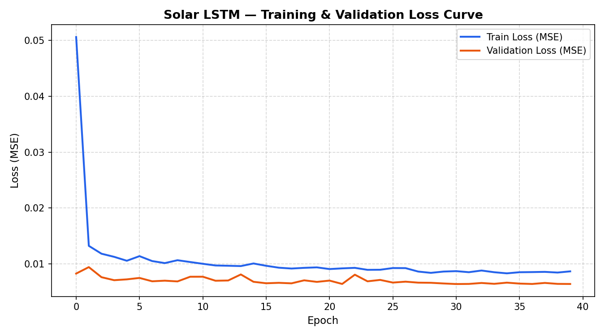
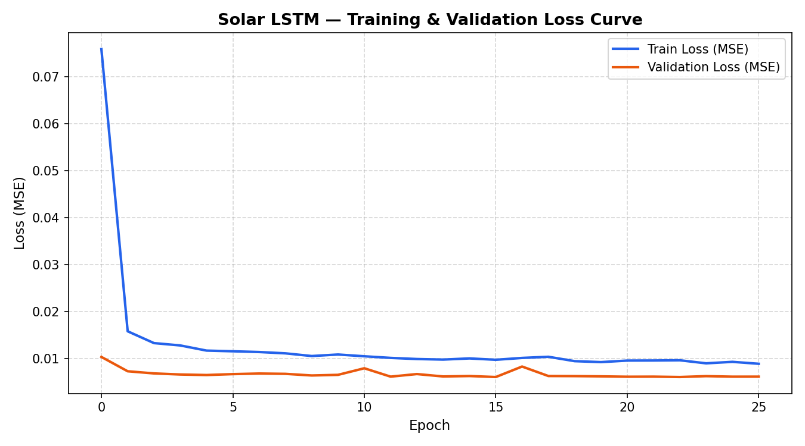
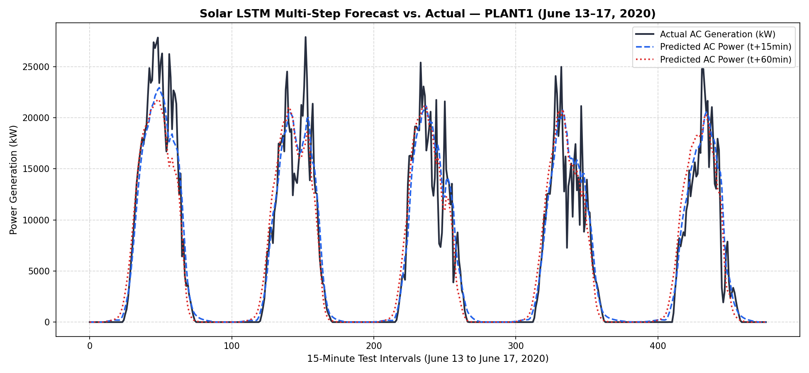
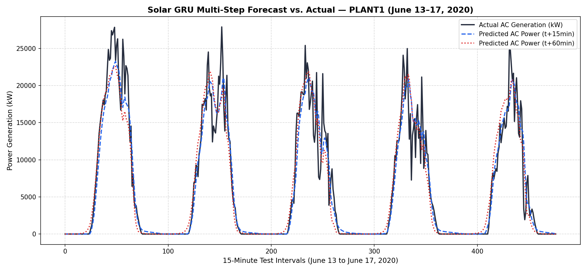

# Experimental Results & Model Benchmarks

**Paper Title**: *Adaptive Multi-Modal AI Framework for Hyperlocal Weather Forecasting in Distributed Solar Rooftop Systems*  
**Course**: DBMS BCSE302L — Digital Assignment 1 (DA-1)  
**Authors**: Revanth P. A. (24BCE1730) & Siripuram Srimannath (24BCE5034)  

---

## 1. Executive Summary

This document reports the empirical benchmarking results of two sequential neural network architectures — **SolarLSTM** and **SolarGRU** — trained on multi-modal telemetry from **Plant 1 (Rooftop Site A — Pune Region)**. Both models were trained on the initial 24 days (May 15 to June 7, 2020), tuned on 5 validation days (June 8 to June 12), and evaluated strictly on the unseen **5-day chronological test partition (June 13 to June 17, 2020)**.

The task is **multi-step ultra-short-term forecasting ($H = 4$ steps)** predicting photovoltaic AC power generation across 15, 30, 45, and 60 minutes ahead ($t+15\text{m}$ to $t+60\text{m}$) using a 24-hour historical lookback window ($L = 96$ time steps).

---

## 2. Model Architectures & Hyperparameters

| Hyperparameter | SolarLSTM | SolarGRU |
| :--- | :--- | :--- |
| **Model Type** | Stacked Long Short-Term Memory | Stacked Gated Recurrent Unit |
| **Input Features ($D$)** | **13 features** | **13 features** |
| **Sequence Lookback ($L$)** | **96 steps** (24.0 hours) | **96 steps** (24.0 hours) |
| **Forecast Horizon ($H$)** | **4 steps** (15–60 min) | **4 steps** (15–60 min) |
| **RNN Layers** | 2 stacked with inter-layer dropout | 2 stacked with inter-layer dropout |
| **Hidden Dimension** | 64 units per cell | 64 units per cell |
| **Dropout Regularization** | 0.20 (RNN) / 0.10 (FC head) | 0.20 (RNN) / 0.10 (FC head) |
| **Total Trainable Parameters** | **55,716** | **42,340** |
| **Loss Function** | MSE on scaled target $[0, 1]$ | MSE on scaled target $[0, 1]$ |
| **Optimizer** | Adam ($\text{lr} = 10^{-3}$, wd $= 10^{-4}$) | Adam ($\text{lr} = 10^{-3}$, wd $= 10^{-4}$) |
| **LR Schedule** | ReduceLROnPlateau (factor=0.5, patience=5) | ReduceLROnPlateau (factor=0.5, patience=5) |
| **Early Stopping** | Patience $= 10$ epochs | Patience $= 10$ epochs |
| **Best Epoch** | Epoch 31 (Val Loss: $0.00639$) | Epoch 26 (Val Loss: $0.00606$) |

---

## 3. Empirical Test Set Performance Comparison

Evaluated on the unseen test partition (June 13 to June 17, 2020 — 477 test sequences):

### 3.1 Overall Horizon Metrics

| Metric | SolarLSTM | SolarGRU | Winner |
| :--- | :--- | :--- | :--- |
| **$R^2$ Score** | **0.9034** | 0.8991 | LSTM |
| **RMSE ($kW$)** | **2,542.68** | 2,598.91 | LSTM |
| **MAE ($kW$)** | **1,377.94** | 1,433.31 | LSTM |
| **Daytime MAPE** | 31.00% | **30.53%** | GRU |
| **Total Parameters** | 55,716 | **42,340** | GRU (24% fewer) |
| **Training Epochs** | 40 (best @ 31) | 40 (best @ 26) | GRU (faster convergence) |

### 3.2 Per-Step Forecast Horizon Breakdown

| Horizon | Metric | SolarLSTM | SolarGRU |
| :--- | :--- | :--- | :--- |
| **$t+15\text{ min}$** | $R^2$ | **0.9221** | 0.9219 |
| | RMSE ($kW$) | **2,283.87** | 2,286.98 |
| | MAE ($kW$) | **1,232.84** | 1,253.54 |
| | MAPE | 27.72% | **25.44%** |
| **$t+30\text{ min}$** | $R^2$ | **0.9075** | 0.9034 |
| | RMSE ($kW$) | **2,488.27** | 2,542.15 |
| | MAE ($kW$) | **1,325.16** | 1,400.31 |
| | MAPE | 29.56% | **29.53%** |
| **$t+45\text{ min}$** | $R^2$ | **0.8972** | 0.8917 |
| | RMSE ($kW$) | **2,623.55** | 2,692.60 |
| | MAE ($kW$) | **1,430.87** | 1,474.74 |
| | MAPE | 32.61% | **32.45%** |
| **$t+60\text{ min}$** | $R^2$ | **0.8869** | 0.8794 |
| | RMSE ($kW$) | **2,751.45** | 2,841.56 |
| | MAE ($kW$) | **1,522.89** | 1,604.64 |
| | MAPE | 34.10% | **34.70%** |

*Key Findings:*
- **SolarLSTM** achieves superior $R^2$, RMSE, and MAE across all forecast horizons, consistent with the LSTM's larger gating capacity (input/forget/output/cell gates vs. GRU's reset/update gates).
- **SolarGRU** delivers competitive short-term MAPE (25.44% at $t+15\text{m}$ vs. LSTM's 27.72%) with **24% fewer parameters** and **faster convergence** (best at epoch 26 vs. 31), making it a practical choice for edge deployment on solar inverter controllers.
- Both architectures exhibit the expected monotonic error degradation from $t+15\text{m}$ to $t+60\text{m}$, consistent with atmospheric volatility principles.

---

## 4. Visualizations

### 4.1 Training & Validation Loss Curves

Both models demonstrated stable convergence without overfitting, aided by inter-layer dropout and learning rate annealing:

| SolarLSTM | SolarGRU |
| :---: | :---: |
|  |  |

### 4.2 Multi-Step Forecast vs. Actual Generation

5-day test partition (June 13 to June 17, 2020) comparing ground-truth AC power generation against the 15-minute ($t+15\text{m}$) and 60-minute ($t+60\text{m}$) forecasts:

| SolarLSTM | SolarGRU |
| :---: | :---: |
|  |  |

---

## 5. Input Feature Vectors ($D = 13$)

| Index | Feature Name | Source / Modality | Unit | Physical Function |
| :--- | :--- | :--- | :--- | :--- |
| 1 | `total_ac_power` | Ground Telemetry (Inverters) | $kW$ | Autoregressive base signal |
| 2 | `sensor_irradiation` | Ground Telemetry (Pyranometer)| $kW/m^2$ | On-site plane-of-array irradiance |
| 3 | `sensor_ambient_temp` | Ground Telemetry (Weather Mast)| $^\circ C$ | Microclimatic surface temperature |
| 4 | `sensor_module_temp` | Ground Telemetry (Back of PV) | $^\circ C$ | Direct thermal degradation proxy |
| 5 | `nasa_ghi` | NASA POWER API (CERES/MERRA-2) | $W/m^2$ | Macro-scale solar irradiance |
| 6 | `nasa_cloud_amt` | NASA POWER API (Satellite) | $\%$ | Cloud attenuation index |
| 7 | `nasa_ambient_temp` | NASA POWER API (MERRA-2) | $^\circ C$ | Regional 2-meter air temperature |
| 8 | `nasa_rh` | NASA POWER API (MERRA-2) | $\%$ | Atmospheric moisture / relative humidity |
| 9 | `nasa_wind_speed` | NASA POWER API (MERRA-2) | $m/s$ | Convective panel cooling factor |
| 10 | `nasa_pressure` | NASA POWER API (MERRA-2) | $kPa$ | Surface atmospheric density |
| 11 | `nasa_clearness_index` | NASA POWER API (Derived) | $[0, 1]$ | Atmospheric transmission ratio ($K_t$) |
| 12 | `hour_sin` | Engineered Cyclical Encoding | $[-1, 1]$ | Continuous diurnal progression |
| 13 | `hour_cos` | Engineered Cyclical Encoding | $[-1, 1]$ | Continuous diurnal progression |

---

## 6. How to Reproduce

To retrain the models and regenerate all figures and benchmark metrics:

```bash
# 1. Ensure dependencies are installed
pip install -r requirements.txt
pip install torch matplotlib

# 2. Train LSTM model
python train_lstm.py --plant plant1 --epochs 40 --batch_size 32 --lr 0.001

# 3. Train GRU model
python train_gru.py --plant plant1 --epochs 40 --batch_size 32 --lr 0.001

# 4. View the generated metrics
cat results/lstm_plant1_metrics.json
cat results/gru_plant1_metrics.json
```

---

## 7. Artifact Checklist

### SolarLSTM
- [x] Model Weights: `models/lstm_plant1_best.pth`
- [x] Loss Curve: `results/figures/lstm_plant1_loss.png`
- [x] Forecast Curve: `results/figures/lstm_plant1_forecast.png`
- [x] Benchmark JSON: `results/lstm_plant1_metrics.json`
- [x] Model Architecture: `model_lstm.py`
- [x] Training Orchestrator: `train_lstm.py`

### SolarGRU
- [x] Model Weights: `models/gru_plant1_best.pth`
- [x] Loss Curve: `results/figures/gru_plant1_loss.png`
- [x] Forecast Curve: `results/figures/gru_plant1_forecast.png`
- [x] Benchmark JSON: `results/gru_plant1_metrics.json`
- [x] Model Architecture: `model_gru.py`
- [x] Training Orchestrator: `train_gru.py`

### Shared
- [x] Training Utility: `train_utils.py`
