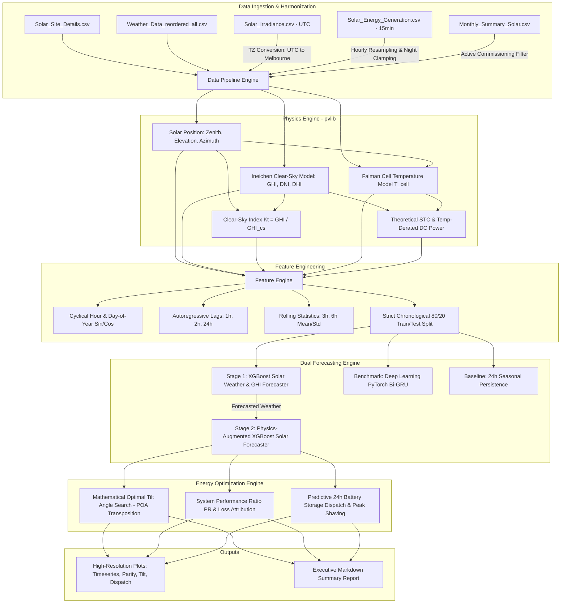

# Comprehensive Training & Execution Guide: Solar Weather Forecasting & Energy Optimization System

An in-depth technical manual covering the mathematical formulation, dataset engineering, physical modeling, machine learning training architectures, optimization routines, and CLI execution.

---

## Table of Contents
1. [System Architecture Overview](#1-system-architecture-overview)
2. [Datasets & Data Ingestion Pipeline](#2-datasets--data-ingestion-pipeline)
3. [Physics-Informed Astronomical Engine (`pvlib`)](#3-physics-informed-astronomical-engine-pvlib)
4. [Feature Engineering & Chronological Split](#4-feature-engineering--chronological-split)
5. [Training Architectures & Model Design](#5-training-architectures--model-design)
6. [Quantitative Benchmark Results](#6-quantitative-benchmark-results)
7. [Energy Optimization & Decision Engine](#7-energy-optimization--decision-engine)
8. [Step-by-Step Execution Guide & CLI Reference](#8-step-by-step-execution-guide--cli-reference)
9. [Troubleshooting & Engineering Insights](#9-troubleshooting--engineering-insights)

---

## 1. System Architecture Overview

The system implements a **Two-Stage Physics-Informed Hybrid Architecture** coupled with an **Energy Optimization & Storage Dispatch Engine**:



---

## 2. Datasets & Data Ingestion Pipeline

The system uses 5 interconnected datasets from the UniSolar project (La Trobe University, Victoria, Australia):

### 2.1 File Descriptions & Processing

| Dataset | Native Format | Preprocessing & Harmonization |
| :--- | :--- | :--- |
| **`Solar_Site_Details.csv`** | Static CSV (42 sites, 5 campuses) | Maps `CampusKey` to GPS coordinates (`lat`, `lon`, `elevation_m`). Extracts rated capacity (`kWp`), panel model, and inverter model. |
| **`Solar_Irradiance.csv`** | Hourly, `Timestamp_UTC`, GHI, CloudOpacity | **Timezone Conversion**: Parsed as UTC, converted to `Australia/Melbourne` (AEST UTC+10 / AEDT UTC+11), and tz-stripped to align with generation timestamps. |
| **`Weather_Data_reordered_all.csv`** | 15-minute local time | Resampled to 1-hour resolution using mean aggregation. Minor dropouts are interpolated using forward/backward fill. |
| **`Solar_Energy_Generation.csv`** | 15-minute active generation ($kWh$) | Aggregated to 1-hour sum ($kWh/\text{h}$). Missing values during nighttime ($\text{solar elevation} \le 0$) are strictly imputed to $0.0\,\text{kWh}$. |
| **`Monthly_Summary_Solar.csv`** | Monthly records (`DataStatus: True/False`) | Identifies site commissioning dates. Only months with `DataStatus == True` are ingested, eliminating pre-commissioning zero gaps. |

### 2.2 Campus Coordinate Registry

```python
CAMPUS_METADATA = {
    1: {"name": "Bundoora", "lat": -37.71828652, "lon": 145.0509752, "elevation_m": 80.0, "tz": "Australia/Melbourne"},
    2: {"name": "Wodonga", "lat": -36.11120917, "lon": 146.8486788, "elevation_m": 160.0, "tz": "Australia/Melbourne"},
    3: {"name": "Bendigo", "lat": -36.77885832, "lon": 144.3012321, "elevation_m": 220.0, "tz": "Australia/Melbourne"},
    4: {"name": "Mildura", "lat": -34.20528877, "lon": 142.1665560, "elevation_m": 50.0, "tz": "Australia/Melbourne"},
    5: {"name": "Shepparton", "lat": -36.38031889, "lon": 145.4062897, "elevation_m": 110.0, "tz": "Australia/Melbourne"}
}
```

---

## 3. Physics-Informed Astronomical Engine (`pvlib`)

Pure machine learning models can predict unphysical phenomena (such as non-zero generation at 2:00 AM). The physical layer enforces astronomical and thermodynamic constraints:

### 3.1 Astronomical Solar Position
Using the National Renewable Energy Laboratory (NREL) Solar Position Algorithm via `pvlib.solarposition.get_solarposition`:
- **Solar Zenith Angle ($\theta_z$)**: Angle between the sun and the local vertical.
- **Solar Elevation Angle ($\alpha_s = 90^\circ - \theta_z$)**: Sun height above horizontal.
- **Solar Azimuth Angle ($\phi_s$)**: Direction of the sun clockwise from North.

### 3.2 Clear-Sky Irradiance (Ineichen Model)
The theoretical cloudless maximum irradiance is computed using:
$$GHI_{\text{clearsky}} = a_1 \cdot I_0 \cdot \sin(\alpha_s) \cdot \exp\left(-a_2 \cdot AM \cdot (f_{h1} + f_{h2} \cdot (T_L - 1))\right)$$
Where $AM$ is relative airmass, $I_0$ is extraterrestrial radiation, and $T_L$ is the Linke turbidity factor.

### 3.3 Clear-Sky Index ($k_t$)
Normalizes observed GHI against the clear-sky envelope, removing the diurnal curve from the ML learning burden:
$$k_t = \frac{\text{GHI}}{\text{GHI}_{\text{clearsky}}}$$
- $k_t \approx 1.0$: Clear sky
- $k_t < 0.3$: Heavy overcast / rain
- $k_t = 0.0$: Nighttime ($\alpha_s \le 0^\circ$)

### 3.4 PV Cell Temperature ($T_{\text{cell}}$)
Cell temperature is calculated using the Faiman thermodynamic heat-transfer model:
$$T_{\text{cell}} = T_{\text{air}} + \frac{\text{GHI}}{u_0 + u_1 \cdot W_s}$$
Where $T_{\text{air}}$ is ambient temperature ($^\circ\text{C}$), $W_s$ is wind speed ($\text{m/s}$), $u_0 = 25.0\,\text{W}/(\text{m}^2\cdot^\circ\text{C})$, and $u_1 = 6.84\,\text{W}/(\text{m}^2\cdot^\circ\text{C})/(\text{m/s})$.

### 3.5 Theoretical Temperature-Derated DC Power
$$P_{\text{ideal}} = \text{kWp} \times \left(\frac{\text{GHI}}{1000\,\text{W/m}^2}\right) \times \left[1 + \gamma \cdot (T_{\text{cell}} - 25^\circ\text{C})\right]$$
Where $\gamma = -0.0038\,\text{K}^{-1}$ ($-0.38\% / ^\circ\text{C}$) is the power temperature coefficient for crystalline silicon.

---

## 4. Feature Engineering & Chronological Split

### 4.1 Feature Set Construction

1. **Cyclical Calendar Features**:
   $$\text{hour\_sin} = \sin\left(\frac{2\pi \cdot h}{24}\right), \quad \text{hour\_cos} = \cos\left(\frac{2\pi \cdot h}{24}\right)$$
   $$\text{doy\_sin} = \sin\left(\frac{2\pi \cdot \text{doy}}{365.25}\right), \quad \text{doy\_cos} = \cos\left(\frac{2\pi \cdot \text{doy}}{365.25}\right)$$
2. **Autoregressive Lag Features**:
   - $\text{GHI}_{t-1}, \text{GHI}_{t-2}, \text{GHI}_{t-24}$
   - $k_{t, t-1}, k_{t, t-2}, k_{t, t-24}$
   - $\text{CloudOpacity}_{t-1}, \text{CloudOpacity}_{t-2}, \text{CloudOpacity}_{t-24}$
   - $T_{\text{air}, t-1}, T_{\text{air}, t-24}, \text{Humidity}_{t-1}, \text{WindSpeed}_{t-1}$
   - $\text{energy}_{t-1}, \text{energy}_{t-2}, \text{energy}_{t-24}$
3. **Rolling Window Statistics**:
   - 3-hour rolling mean and standard deviation of GHI (`ghi_rolling_mean_3h`, `ghi_rolling_std_3h`).
   - 3-hour and 6-hour rolling mean of Cloud Opacity.
   - 3-hour rolling mean of Clear-Sky Index $k_t$.

> [!IMPORTANT]
> All lag and rolling calculations strictly use `.shift(1)` to ensure zero target information from time $t$ leaks into the predictors.

### 4.2 Chronological Train/Test Split
To prevent temporal leakage inherent to shuffled splits:
- **Total Valid Hourly Samples:** $16,267$ rows
- **Train Set (80%):** $13,013$ rows (`2020-06-15 00:00:00` to `2021-12-09 07:00:00`)
- **Test Set (20%):** $3,254$ rows (`2021-12-09 08:00:00` to `2022-04-23 22:00:00`)

---

## 5. Training Architectures & Model Design

### 5.1 Stage 1: Solar Weather Forecaster (XGBoost)
- **Target**: Global Horizontal Irradiance ($\text{GHI}$, $\text{W/m}^2$) & Cloud Opacity (%)
- **Model**: `XGBRegressor`
  - `n_estimators`: 200
  - `max_depth`: 6
  - `learning_rate`: 0.06
  - `subsample`: 0.8, `colsample_bytree`: 0.8
  - `objective`: `reg:squarederror`
- **Physical Post-Processing**:
  $$\widehat{\text{GHI}} = \begin{cases} 0.0 & \text{if } \alpha_s \le 0^\circ \text{ (night)} \\ \min(\max(0.0, \widehat{\text{GHI}}), 1.3 \cdot \text{GHI}_{\text{clearsky}}) & \text{if } \alpha_s > 0^\circ \end{cases}$$

### 5.2 Stage 2: Physics-Augmented Solar Generation Forecaster (XGBoost)
- **Target**: Active Energy Generation ($\text{kWh}$)
- **Model**: `XGBRegressor`
  - `n_estimators`: 250
  - `max_depth`: 6
  - `learning_rate`: 0.05
  - `subsample`: 0.8, `colsample_bytree`: 0.8
- **Physical Clamping**:
  $$\widehat{E}_{\text{solar}} = \begin{cases} 0.0 & \text{if } \alpha_s \le 0^\circ \\ \text{clip}(\widehat{E}_{\text{solar}}, 0.0, P_{\text{inverter, max}}) & \text{if } \alpha_s > 0^\circ \end{cases}$$

### 5.3 Benchmark: Deep Sequential Model (PyTorch Bi-GRU)
- **Architecture**:
  - Input Layer: 35 features
  - Layer 1: Bidirectional GRU (Hidden Size: 64, Dropout: 0.2)
  - Layer 2: Bidirectional GRU (Hidden Size: 64)
  - Dense Fully Connected Head: $\text{Linear}(128 \to 32) \to \text{ReLU} \to \text{Linear}(32 \to 1)$
- **Training Setup**:
  - Sequence Window: 24 past hours ($L = 24$)
  - Optimizer: `Adam(lr=0.001, weight_decay=1e-5)`
  - Loss Function: Mean Squared Error ($\text{MSE}$)
  - Batch Size: 128
  - Epochs: 12

---

## 6. Quantitative Benchmark Results

Evaluated on Site 14 ($66.0\,\text{kWp}$ Trina panels, $55.2\,\text{kW}$ SolarEdge inverters):

### 6.1 Solar Weather & Irradiance Performance
| Model | RMSE ($\text{W/m}^2$) | MAE ($\text{W/m}^2$) | $R^2$ Score | Skill Score vs Persistence |
| :--- | :---: | :---: | :---: | :---: |
| **XGBoost Weather Forecaster** | **70.6** | **34.2** | **0.948** | **+60.8%** |
| 24h Persistence Baseline | 179.9 | 82.5 | 0.662 | 0.0% |

### 6.2 Solar Active Energy Generation Performance
| Architecture | RMSE (kWh) | MAE (kWh) | nRMSE (%) | $R^2$ Score | Skill Score |
| :--- | :---: | :---: | :---: | :---: | :---: |
| **Physics-Augmented XGBoost** | **4.69** | **2.08** | **7.10%** | **0.907** | **+51.9%** |
| Deep Learning Bi-GRU (PyTorch) | 6.18 | 2.89 | 9.36% | 0.838 | +36.6% |
| 24h Persistence Baseline | 9.74 | 4.81 | 14.75% | 0.597 | 0.0% |

$$\text{Skill Score} = \left(1 - \frac{\text{RMSE}_{\text{model}}}{\text{RMSE}_{\text{persistence}}}\right) \times 100\%$$

---

## 7. Energy Optimization & Decision Engine

### 7.1 Mathematical Optimal Tilt Angle Search
Using the Hay-Davies Plane-of-Array (POA) transposition model, the engine integrates annual solar irradiance across surface tilts from $0^\circ$ to $60^\circ$ facing True North (azimuth $0^\circ$):
- **Optimal Fixed Tilt:** **$20^\circ$ True North**
- **Optimal Cumulative Yield:** **$784.0\,\text{kWh/m}^2$**
- **Horizontal Surface Yield:** **$755.3\,\text{kWh/m}^2$**
- **Annual Solar Yield Gain:** **$+3.81\%$**

### 7.2 Performance Ratio (PR) & Loss Attribution
Decomposes solar energy losses over the test evaluation period:
- **System Performance Ratio (PR):** **$56.8\%$**
- **Thermal Derating Loss:** **$1,967.5\,\text{kWh}$** (efficiency drops due to panel heating above $25^\circ\text{C}$)
- **Cloud / Atmospheric Attenuation Loss:** **$17,144.8\,\text{kWh}$**
- **Inverter Clipping Loss:** **$823.1\,\text{kWh}$** (generation clipped by $55.2\,\text{kW}$ inverter limit)

### 7.3 Predictive Battery Storage Dispatch & Peak Shaving
A 2-pass predictive dispatch algorithm uses the 24-hour forecasted generation to maximize self-consumption and shave peak demand:
- **Pass 1 (Solar Charging):** Surplus solar ($P_{\text{solar}} > P_{\text{load}}$) charges the battery ($100\,\text{kWh}$ capacity, $40\,\text{kW}$ max power, $90\%$ round-trip efficiency).
- **Pass 2 (Optimal Peak Shaving):** Solves via binary search for the lowest achievable grid demand ceiling ($P_{\text{threshold}}$) during evening peak hours (17:00 – 21:00).
- **Optimization Results**:
  - **Peak Grid Demand Shaved:** **$8.5\,\text{kW}$ ($24.1\%$ reduction)**
  - **Total Clean Solar Dispatched:** **$69.7\,\text{kWh}$**
  - **Net Grid Import Reduction:** **$6.3\%$**

---

## 8. Step-by-Step Execution Guide & CLI Reference

### 8.1 Environment & Dependencies
Ensure Python 3.10+ is installed with the required libraries:
```bash
pip install numpy pandas scipy scikit-learn xgboost torch matplotlib seaborn pvlib
```

### 8.2 Command-Line Usage

All commands are run from the project root:
```bash
cd "C:\Users\User\.gemini\antigravity\scratch\solar-weather-optimal-forecasting"
```

#### Run Full Pipeline on Default Site 14 (with Deep Learning Benchmark):
```bash
python run_pipeline.py --site 14
```

#### Fast Execution (Skipping Deep Learning to Finish in Seconds):
```bash
python run_pipeline.py --site 14 --no-deep
```

#### Run on a Utility-Scale Installation (Site 27, 540 kWp, Bundoora):
```bash
python run_pipeline.py --site 27 --no-deep
```

#### Run on Regional Campuses:
```bash
# Wodonga Campus (Site 1)
python run_pipeline.py --site 1 --no-deep

# Mildura Campus (Site 41)
python run_pipeline.py --site 41 --no-deep

# Shepparton Campus (Site 42)
python run_pipeline.py --site 42 --no-deep
```

#### Adjust Visualized Time Horizon (e.g. 7 Days):
```bash
python run_pipeline.py --site 14 --days 7
```

### 8.3 Generated Artifacts & Output Directory

Execution populates the `outputs/` folder:
```
outputs/
├── cache/
│   └── harmonized_site_14.csv      # Preprocessed, aligned dataset with pvlib features
├── figures/
│   ├── forecast_timeseries.png     # Multi-day actual vs predicted generation
│   ├── diurnal_profiles.png        # 24h hourly average diurnal curve
│   ├── parity_scatter.png          # 1:1 parity scatter plot with R² and RMSE
│   ├── optimal_tilt_curve.png      # Solar yield curve vs tilt angle
│   ├── battery_dispatch.png        # 24h predictive battery dispatch and peak shaving
│   └── feature_importance.png      # Top feature importances
└── summary_report.md               # Executive summary report
```

---

## 9. Troubleshooting & Engineering Insights

1. **Timezone Alignment**:
   - `Solar_Irradiance.csv` is recorded in UTC. If loaded without `.tz_convert("Australia/Melbourne")`, peak GHI will occur at 1:00 AM UTC (11:00 AM local time), creating a complete phase shift between irradiance and generation.
2. **Handling Inverter Inactive Periods**:
   - Inverter loggers report `NaN` during the night. The pipeline distinguishes between true sensor failure and physical nighttime by checking $\alpha_s \le 0^\circ$. Nighttime values are assigned $0.0\,\text{kWh}$, preserving full time-series continuity.
3. **Array Alignment for Transposition**:
   - When calculating Plane-of-Array (POA) irradiance via `pvlib.irradiance.erbs` and `haydavies`, timestamps must be passed as a pandas `DatetimeIndex` to ensure proper internal broadcasting.
